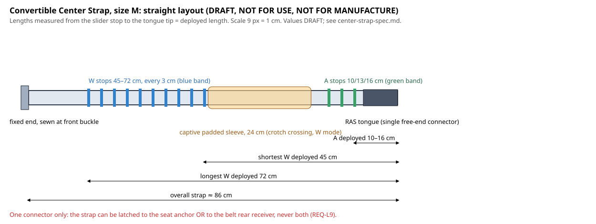

# Convertible Center Strap Detailed Design Spec (v0.1)

> 🚧 **DRAFT: not reviewed by a qualified engineer; not for use.** Not released until the MVP review gate. See [SAFETY-NOTICE](../../SAFETY-NOTICE.md).

Task `ridebelt-design-004` · License: CC BY 4.0 (text, drawing), MIT ([center-strap/center_strap_geometry.py](center-strap/center_strap_geometry.py)) · Prepared with AI assistance (Claude Code) · **Not for manufacture.**

## 1. Role and modes
The Convertible Center Strap is the anti-submarine module ([concepts.md](concepts.md)). One strap, fixed at the Hip Belt's front buckle ([hip-belt-spec.md](hip-belt-spec.md) §4.3), with **two modes**:

| Mode | Where the free end latches | Path | Required on |
|---|---|---|---|
| **A (anchor) mode, 3-point tie-down** | RAS-3 center anchor on the seat pan, between the thighs and forward of the hip point | Short, **down and forward** from the buckle; nothing between the legs | Preferred on RAS-3 seats; recommended on every ride class |
| **W (wearable) mode, crotch strap** | Rear receiver on the Hip Belt (rear centre, lower edge) | Front buckle → between the legs → rear receiver | Drop towers and dangling-leg seats without a center anchor (REQ-H4) |

## 2. Requirements this spec addresses
| Requirement | How |
|---|---|
| REQ-L9 (single connector; modes mutually exclusive; length only at sewn stops; mode colour band) | §3, §4.1, §4.3 |
| REQ-L8 (A mode runs down and forward, never loads the groin; length ≤ TBD) | §4.2 |
| REQ-L2 (≥ 30 kN in both modes) | §4.4 |
| REQ-H2 (no snag), H20 (groin), H22 (wrong mode or length) | §3, §4.5 |
| REQ-H4 (anti-submarine required on drop towers and dangling-leg seats) | §1 |
| REQ-F1 (sizes) | §4.3, size table |

## 3. Why dual-mode use is impossible by construction
1. The strap has **exactly one free end**, carrying **one RAS tongue** ([ras-latch.md](ras-latch.md) §2). The other end is **permanently sewn** to the front buckle and can't be unclipped.
2. Latching the tongue into the **seat's** RAS-3 center anchor uses it up, so there's nothing left to latch into the **belt's** rear receiver, and the reverse.
3. There's no second connector, loop or clip anywhere along the strap that could be hooked to anything. Stow pocket closures and sleeves are fabric, with no rated attachment points.
4. So the dangerous combined set-up, where a rising rider would pull a seat-anchored strap up into the groin (H20), can't be assembled. This isn't a rule riders must follow; there's simply no hardware to do it with.

## 4. Construction
### 4.1 Sewn stop ladders and the slider (REQ-L9, H22)
The original concept had one A stop and one W stop. **The anthropometry shows a single W stop can't fit snugly:** within each belt size, the required W length spans about 23 cm from the 1st to the 99th percentile (§4.3). This spec therefore uses **ladders of sewn stops**:
- **A ladder:** 3 sewn stops (CS-A1).
- **W ladder:** sewn stops every 3 cm (CS-A4).
- A **captive locking slider** (a forged bar that engages one sewn stop pocket at a time) sets the deployed length.
- **Sewn stop pockets are closed bar-tacked pockets.** The slider can only rest in a pocket, never between pockets, and can't slip under load.

This keeps the safety intent of REQ-L9 (no free, slippable adjustment; length set only by sewn stops), but **it departs from REQ-L9's literal wording of "two sewn stops"**. **Proposed requirement change for the requirements owner:** REQ-L9 to read "length is set only at sewn stop positions (an A ladder and a W ladder), with no slip between positions at rated load."

**Mode colour band (REQ-L9):** the strap section between the slider and the buckle shows through a window at the buckle.
- When the slider is in any **A** stop, the window shows **green**.
- When it's in any **W** stop, the window shows **blue**.
- Stops are colour-coded on the webbing itself (green A pockets, blue W pockets), so the operator can confirm the mode from the platform.

### 4.2 A mode (REQ-L8)
| Item | Value | Basis |
|---|---|---|
| Deployed length at the A stops (slider stop to tongue tip) | **10 / 13 / 16 cm** | CS-A1, from the concept geometry: the belt front sits about 20 mm below the hip point and the RAS-3 center zone is on the seat pan about 90 mm below it, 110–220 mm forward ([geometry/concept_geometry.py](geometry/concept_geometry.py)). The tongue's reach must span about 7 cm of drop plus up to about 12 cm forward. Three stops absorb variation in buckle position between bodies |
| Direction | Down and forward from the buckle; **never upward toward the groin** | REQ-L8, H20. Depends on RAS-3 anchor placement forward of the hip point (RAS §3.1a) |
| Energy absorber | **None** | concepts.md: it locates the belt, and the side tethers carry the ejection load |
| Belt movement with all three points clipped | ≤ TBD mm | REQ-L8; T-D5 |

### 4.3 W mode and sizes (REQ-F1)
W length is derived from the ANSUR II crotch length (omphalion) fitted against fit girth. The deployed W length subtracts the drop from navel level to the belt line, front and rear (CS-A2). The table is generated by `center_strap_geometry.py`:

Fit (ANSUR II, n = 6068): crotch length omphalion ≈ 18.8 + 0.409 × fit girth (cm); residual SD 3.28 cm.

| Belt size | Required W length, P1–P99 (cm) | W stop ladder (cm) | Number of W stops (every 3 cm) |
|---|---|---|---|
| XS | 32.7–56.2 | 30–57 | 10 |
| S | 39.3–62.7 | 39–63 | 9 |
| M | 45.8–69.3 | 45–72 | 10 |
| L | 52.4–75.8 | 51–78 | 10 |
| XL | 58.9–82.4 | 57–84 | 10 |

- Each belt size has its own strap length. The Center Strap is sized with the belt and has the same size label.
- **L and XL rely on extrapolation.** ANSUR II has only 20 subjects in the L girth range and none in XL. Their W ladders come from the regression, not from measured people in those sizes. **Fit work must confirm them.**
- With 3 cm stops, the worst-case slack in W mode before the pad compresses is under 3 cm (CS-A4). Whether that's acceptable for anti-submarine function is to be checked in T-D2 (drop-tower pulse).

### 4.4 Ratings (REQ-L2)
| Element | Rating |
|---|---|
| Strap webbing (polyester HT, 25–38 mm, width per CS-A5), sewn stop pockets, slider, sewn fixed end at the buckle | **≥ 30 kN MBS** in both modes, after joint efficiency (standard, minus one SD; [materials-webbing.md](../research/materials-webbing.md) §3) |
| RAS tongue | ≥ 30 kN ([ras-latch.md](ras-latch.md) §2) |
| Rear receiver on the belt (W mode) | ≥ 30 kN ([hip-belt-spec.md](hip-belt-spec.md) §4.3) |

### 4.5 Padding, stowage and snag control
- **Captive padded sleeve:** 24 cm long, closed-cell foam, on the strap section between the shortest W stop and the A stops (see drawing). In W mode it sits where the strap crosses the crotch. In A mode it's behind the slider and goes into the stow pocket with the spare length. The sleeve is captive between stops and can't slide off.
- **Stow pocket** (on the Hip Belt front, [hip-belt-spec.md](hip-belt-spec.md) §4.8): holds all strap length behind the slider in A mode, closed so nothing hangs loose (REQ-H2).
- No loops, rings or connectors anywhere along the strap other than the single tongue (§3).

## 5. Drawing

[center-strap/center_strap_layout_M.svg](center-strap/center_strap_layout_M.svg) shows the size M straight layout: fixed end, W ladder (blue), padded sleeve, A ladder (green) and tongue, with the deployed-length dimensions. Regenerate it with `python docs/design/center-strap/center_strap_geometry.py <data_dir>` (ANSUR II files; see [anthropometry-adult.md](../research/anthropometry-adult.md)).

## 6. Design assumptions (for engineer review)
| ID | Assumption | Value | To be confirmed by |
|---|---|---|---|
| CS-A1 | A-mode deployed lengths | 10 / 13 / 16 cm | Mannequin fit on generic RAS-3 seat geometry (`ridebelt-cad-003`); T-D5 |
| CS-A2 | Belt line sits about 6 cm below navel (omphalion) level, front and rear, so W length = crotch length (omphalion) − 12 cm | −12 cm | Mannequin and ATD fit; seated posture may change it |
| CS-A3 | ANSUR II regression stands in for civilians, including L and XL extrapolation | — | Civilian fit data; fit trials after the MVP gate |
| CS-A4 | W stop spacing | 3 cm | T-D2 anti-submarine performance with up to 3 cm slack |
| CS-A5 | Strap webbing width | 25–38 mm | Narrower than the belt's 50 mm for comfort between the legs; width chosen by T-S1 to reach 30 kN |

## 7. Verification
| Test | Checks |
|---|---|
| T-S1, T-S2 | 30 kN rating of strap, stops, slider and fixed end; no slip between stops |
| T-F8 | Mode change by untrained users; operators read the mode from the platform; dual-mode attachment impossible |
| T-D2, T-D5 | Anti-submarine function in each mode; A-mode geometry, groin load and belt movement |
| T-F7 | Snag and entanglement with the stow pocket and sleeve |

## 8. Open items
1. **Requirements owner:** REQ-L9 wording change for stop ladders (§4.1).
2. A-stop lengths and RAS-3 center-zone placement to be set together (`ridebelt-cad-003`, `ridebelt-ras-002`).
3. Civilian validation of the W ladders, especially L and XL (CS-A3).
4. Whether 3 cm stop spacing is acceptable, or whether 2 cm (more stops) is needed (CS-A4, T-D2).
