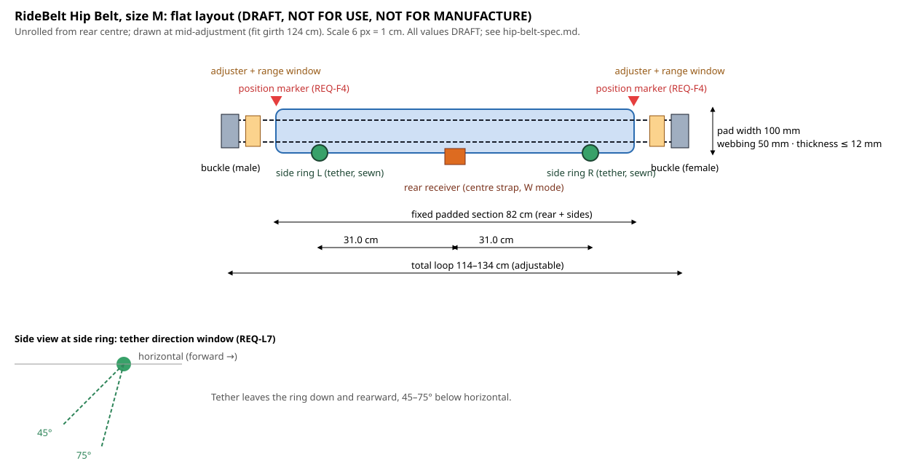

# Hip Belt Detailed Design Spec (v0.1)

> 🚧 **DRAFT: not reviewed by a qualified engineer; not for use.** Not released until the MVP review gate. See [SAFETY-NOTICE](../../SAFETY-NOTICE.md).

Task `ridebelt-design-001` · License: CC BY 4.0 (text, drawing), MIT ([hip-belt/hip_belt_geometry.py](hip-belt/hip_belt_geometry.py)) · Prepared with AI assistance (Claude Code) · **Not for manufacture.**

## 1. Role
The Hip Belt is RideBelt's core product. It sits **low on the pelvis, never at the waist**, and carries the ejection load from the rider's pelvis into two short side tethers. The tethers run **down and rearward** to seat anchors ([concepts.md](concepts.md)). Modules attach to it: the clip-on Shoulder Module, the Convertible Center Strap and, in the Integrated Harness, permanently sewn shoulder straps.

## 2. Requirements this spec addresses
| Requirement | How |
|---|---|
| REQ-L2 (MBS ≥ 30 kN per load path) | Every load-path part of the belt is rated ≥ 30 kN MBS (§4.1) |
| REQ-L4 (slack, excursion) | Low-stretch polyester load webbing; thin, firm pad (§4.1, §4.4) |
| REQ-L5 (two independent tethers) | Two separate side rings, each with its own sewn tether (§4.2) |
| REQ-L6 (belt stays on the pelvis) | Contour, stiffener and tether exit geometry (§4.4, §4.5) |
| REQ-L7 (tethers 45–75° down and rearward) | Side-ring position and exit direction (§4.2, drawing) |
| REQ-F1 (1st–99th percentile, both sexes) | Five sizes from [sizing.md](sizing.md), fitting 99.6% of US adults (§5) |
| REQ-F3, REQ-F4 (fit check, position guide) | Adjuster range windows, snugness gauge tab, position markers (§4.6) |
| REQ-O4, REQ-O5 (no restraint interference; inside the clearance envelope) | Pad thickness ≤ 12 mm; nothing protrudes above or forward of the pad (§4.4) |
| REQ-H2 (no snag hazards) | Elastic keepers on all strap tails; stow pocket (§4.8) |
| REQ-D1–D4, REQ-T1, REQ-T3 | Materials, labels, serial and tag, theming zones (§4.9) |

## 3. Design assumptions (for engineer review)
Every dimension is either derived from a requirement or analysis, or listed here.

| ID | Assumption | Value | Basis / to be confirmed by |
|---|---|---|---|
| HB-A1 | Load-spreading pad width (sides and rear) | 100 mm | Wider than seat-belt webbing (about 50 mm) to lower pressure on the pelvis. Rough check: 6 kN over about 30 cm of contact × 0.10 m ≈ 200 kPa **[estimate]**. Confirm against REQ-L3 thresholds (`ridebelt-biomech-001`) and T-D2 |
| HB-A2 | Load webbing width | 50 mm | Seat-belt-class polyester webbing ([materials-webbing.md](../research/materials-webbing.md)) |
| HB-A3 | Total pad thickness | ≤ 12 mm | Lap-bar and OTSR clearance (REQ-O4); confirm in T-F5 |
| HB-A4 | Pad extends past each side ring toward the front | 10 cm | Spreads load ahead of the ring and carries the position marker |
| HB-A5 | Side rings placed on the lateral midline at mid-size girth (girth ÷ 4 from rear centre) | — | Rings stay within ±2.5 cm of the true side across each size's 20 cm range (§5 table) |
| HB-A6 | Position marker distance forward of each side ring | about 8% of girth (≈ 10 cm in size M) | Approximates the pelvic-bone (ASIS) line. **Must be confirmed on mannequins and ATDs** |
| HB-A7 | Contour: belt shaped as part of a cone, lower edge longer than upper edge | Cone angle TBD | So the belt sits across the pelvic bones and tops of the thighs and resists riding up (REQ-L6). Set by mannequin fit work and T-D3 |
| HB-A8 | Side stiffener | 1.5 mm HDPE sheet in the side sections, not the rear | Holds contour and stops rolling; carries no load |
| HB-A9 | Snugness gauge tab thickness | About two finger widths (value TBD) | Turns the "two-finger rule" into an objective check ([sizing.md](sizing.md) §4) |
| HB-A10 | Front loop load (adjusters, buckle) | Rated as a full 30 kN load path | Conservative until loop tension is calculated (A4 FEA) and measured (T-S1). The real loop tension may be lower |

## 4. Construction
### 4.1 Load path and ratings
Load path: **rider pelvis → pad → load webbing loop → side ring → sewn tether → anchor.**

| Element | Spec | Rating |
|---|---|---|
| Load webbing loop | Continuous high-tenacity **polyester** webbing, 50 mm (HB-A2), running through the whole belt (rear, sides, front) | Loop including joints **≥ 30 kN MBS** after joint efficiency (standard efficiency, minus one SD), per [materials-webbing.md](../research/materials-webbing.md) §3. Expect 2 plies, or one heavier ply, to reach this; chosen by T-S1 |
| Side rings (×2) | Forged alloy-steel D-rings, corrosion-protected (REQ-D2), captured in a sewn webbing pocket on the load loop | ≥ 30 kN MBS each. Common fall-protection D-rings are rated around 22 kN **[to verify in `ridebelt-hardware-001`]**, so a higher-rated or custom ring is likely |
| Sewn joints | Machine bar-tack or W-pattern, chosen by test; bonded polyester thread in a contrasting colour | Joint efficiency measured by the NASA standard-efficiency method (T-S1) |
| Front adjusters (×2, one each side of the buckle) | Locking cam or double-pass adjusters with a **range window** (§4.6) | ≥ 30 kN in the loop (HB-A10); slip ≤ TBD at rated load (T-S2) |
| Front buckle | Two-action metal buckle (needs two separate motions to open); can't open under load | ≥ 30 kN (HB-A10). This is the rider's own closure; the seat-side release stays at the RAS anchor, operator only |

### 4.2 Tether attachment (REQ-L5, REQ-L7)
- Each side tether is **sewn permanently** through its own side ring, or attached with a captive pin. The rider never connects or disconnects tethers at the belt ([ras-latch.md](ras-latch.md) §2).
- The two rings are fully independent, and either tether alone carries the full load (REQ-L5).
- **Ring position:** on the lower edge of the pad at the lateral midline (HB-A5), so the tether leaves **down and rearward at 45–75° below horizontal** (REQ-L7), toward an anchor placed per RAS §3.1. The drawing shows this window.

### 4.3 Module attachment points
| Point | Location | Purpose | Load path? |
|---|---|---|---|
| Front fixed end of the Convertible Center Strap | Sewn at the front buckle (female half) | The center strap's permanent end ([concepts.md](concepts.md)) | Yes, center-strap load case (REQ-L8, REQ-L2) |
| Rear receiver | Rear centre, lower edge | Accepts the center strap's RAS tongue in **wearable (W) mode** | Yes, ≥ 30 kN (REQ-L2) |
| Shoulder attachment points (×4) | Two at the front (near the adjusters), two at the rear (either side of the receiver) | Clip-on Shoulder Module connectors (keyed, so they can't be fitted wrongly), or sewn straps in the Integrated Harness | Not the main load path; rated for the shoulder load case (`ridebelt-design-002` and `-003`) |

### 4.4 Pad, contour and stiffener
- **Pad:** 100 mm wide (HB-A1) across the rear and sides, extending 10 cm forward of each ring (HB-A4). Total thickness ≤ 12 mm (HB-A3). Closed-cell foam (no water uptake, for rain and sweat, REQ-D1) under a breathable inner liner and an abrasion-resistant polyester outer.
- **The pad is not part of the load path.** It spreads pressure and holds shape.
- **Contour:** cone-section shape (HB-A7), so the lower edge lies over the tops of the thighs and the upper edge on the pelvic bones.
- **Stiffener:** 1.5 mm HDPE sheet in the side sections only (HB-A8), for shape and to resist rolling. None in the rear, where flexibility helps the belt sit against seat backs.
- **Profile:** nothing protrudes above the pad's upper edge or forward of the front section, to keep clear of lap bars and over-the-shoulder restraints (REQ-O4, REQ-O5).

### 4.5 Why the belt stays low (REQ-L6)
- The tethers pull down and rearward from rings on the lower edge, so load pulls the belt **toward** the thighs, never up toward the abdomen ([load-analysis.md](../analysis/load-analysis.md); [concepts.md](concepts.md)).
- The cone contour and side stiffeners resist rolling up.
- On drop towers and dangling-leg seats, the Convertible Center Strap holds the front edge down (REQ-H4).
- To be shown in T-D2 and T-D3: belt migration ≤ TBD mm on an ATD.

### 4.6 Built-in fit-check features (REQ-F3, REQ-F4)
From [sizing.md](sizing.md) §4:
1. **Range window** on each front adjuster: a coloured band visible only while the adjuster is inside its rated range.
2. **Position markers:** red triangles on the upper edge at the pelvic-bone line (HB-A6), on both sides.
3. **Snugness gauge tab** on the inner upper edge (HB-A9).
4. **Size and module label** at the buckle, plus the passive tag (REQ-T3).

### 4.7 Connectors and IP constraints
- No seat-side connector is on the belt. Tethers end in RAS tongues or wrap-strap snap hooks, per [ras-latch.md](ras-latch.md).
- No leg flaps or leg loops, and no vest structure (FTO design-around; [patentability-fto.md](../research/patentability-fto.md)).

### 4.8 Snag control (REQ-H2)
- All adjuster tails are captured by elastic keepers.
- A closed **stow pocket** at the front holds the center strap's spare tail in anchor mode ([concepts.md](concepts.md)).
- No dangling loops.

### 4.9 Labels, identity, durability, theming
- **Labels** on an inner label panel, protected from abrasion: serial number and anti-counterfeit mark (REQ-D4), size, ratings, ride-class module requirements, service life and retirement rule (REQ-D3). Wording is drafted under `ridebelt-labels-001`.
- **Passive tag** (REQ-T3), sealed in the rear pad.
- **Durability:** textiles and thread keep ≥ 80% strength after UV, washing and wet exposure (REQ-D1). Metal parts pass corrosion testing (REQ-D2).
- **Theming zones** (REQ-T1): the outer face of the pad only. Themed shells never cover the rings, adjusters, range windows, buckle, markers, gauge tab or labels.

## 5. Sizes (REQ-F1)
Size chart from [sizing.md](sizing.md): 5 sizes, each with 20 cm of adjustment and ≥ 4 cm overlap, covering **99.6% of US adults** (NHANES 2021–2023 hip circumference plus a 4 cm clothing allowance). Per-size layout, generated by `hip_belt_geometry.py`:

| Size | Fit girth (cm) | Fixed padded section, rear + sides (cm) | Side ring from rear centre, each side (cm) | Adjustable front section (cm) | Ring offset from true side at size limits (± cm) |
|---|---|---|---|---|---|
| XS | 82–102 | 66 | 23.0 | 16–36 | 2.5 |
| S | 98–118 | 74 | 27.0 | 24–44 | 2.5 |
| M | 114–134 | 82 | 31.0 | 32–52 | 2.5 |
| L | 130–150 | 90 | 35.0 | 40–60 | 2.5 |
| XL | 146–166 | 98 | 39.0 | 48–68 | 2.5 |

## 6. Drawing

[hip-belt/hip_belt_layout_M.svg](hip-belt/hip_belt_layout_M.svg) shows the size M flat layout with dimensions, plus the side-view tether window. Regenerate it with `python docs/design/hip-belt/hip_belt_geometry.py`.

## 7. Bill of materials (per belt, DRAFT)
| # | Part | Qty | Spec | Source / requirement |
|---|---|---|---|---|
| 1 | Load webbing, polyester HT, 50 mm | Loop length plus joint overlaps (size-dependent) | ≥ 30 kN loop MBS after joints; FMVSS 209-class or better; UV retention ≥ 80% | REQ-L2, REQ-D1; materials-webbing.md |
| 2 | Side D-ring, forged alloy steel | 2 | ≥ 30 kN MBS; corrosion-protected | REQ-L2, REQ-L5, REQ-D2 |
| 3 | Front buckle, two-action metal | 1 | ≥ 30 kN; can't open under load | REQ-L2 (HB-A10) |
| 4 | Locking adjuster with range window | 2 | ≥ 30 kN in loop; slip ≤ TBD | REQ-L2, REQ-F3; T-S2 |
| 5 | Rear receiver (wearable RAS-tongue receiver) | 1 | ≥ 30 kN; keyed; positive latch indication | REQ-L2, REQ-L9; ras-latch.md |
| 6 | Shoulder attachment points (keyed) | 4 | Rated for the shoulder load case | design-002 / design-003 |
| 7 | Closed-cell foam pad | 1 | ≤ 12 mm total build; non-absorbent | HB-A1, HB-A3, REQ-D1 |
| 8 | HDPE side stiffeners, 1.5 mm | 2 | Shape only | HB-A8 |
| 9 | Outer cover and inner liner fabric | 1 set | Abrasion-resistant polyester outer; breathable liner | REQ-D1 |
| 10 | Bonded polyester thread, contrasting colour | — | Matched to the webbing | materials-webbing.md §3 |
| 11 | Position markers, gauge tab, label panel | 1 set | Per §4.6 and §4.9 | REQ-F3, REQ-F4, REQ-D3, REQ-D4 |
| 12 | Passive crypto tag | 1 | Sealed | REQ-T3 |
| 13 | Elastic keepers, stow pocket | 1 set | — | REQ-H2 |

Tethers, absorbers and anchor-end connectors belong to the Tether Kit ([ras-latch.md](ras-latch.md), `ridebelt-design-005`) and aren't in this BOM.

## 8. Verification
| Test | What it checks here |
|---|---|
| T-S1 | Loop, ring, joint and receiver strength ≥ 30 kN; standard joint efficiency |
| T-S2 | Adjuster and buckle slip |
| T-D2, T-D3 | Belt stays on the pelvis (REQ-L6) within the 45–75° tether window; pressure and injury criteria (REQ-L3) |
| T-F3 | Fit check in under 10 s with the built-in features (mannequins before the MVP gate; people only after it) |
| T-F5 | Restraint interference and clearance with the 12 mm pad |
| T-E1, T-E2, T-E3 | UV, wash and wet durability; corrosion |

## 9. Open items
1. Loop tension from FEA (A4) and test, to confirm or relax HB-A10.
2. Cone angle (HB-A7) and marker position (HB-A6) from mannequin fit work.
3. Source or design a ≥ 30 kN side ring and buckle (`ridebelt-hardware-001`).
4. Pressure check of the 100 mm pad against REQ-L3 thresholds once `ridebelt-biomech-001` is done.
